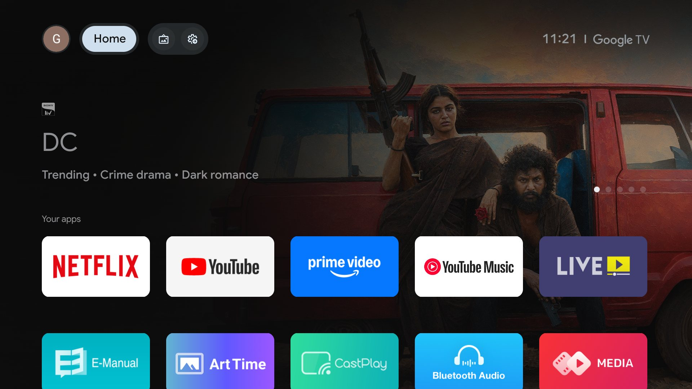
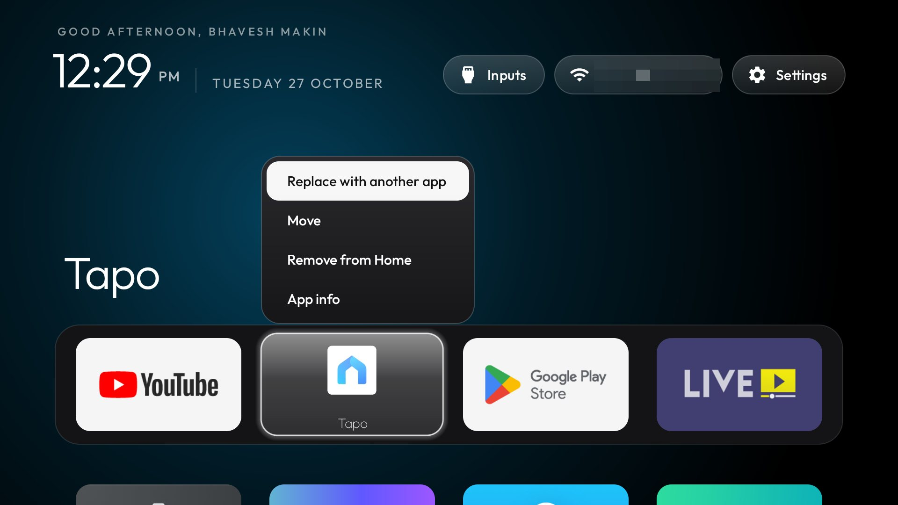
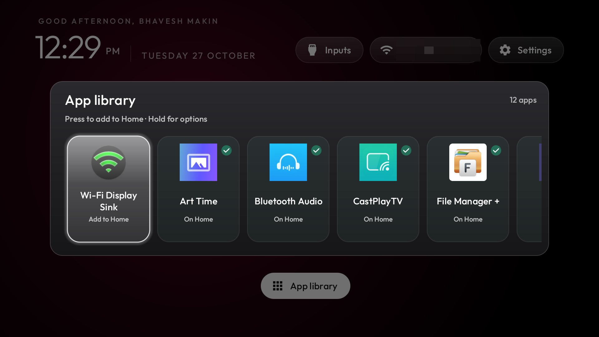
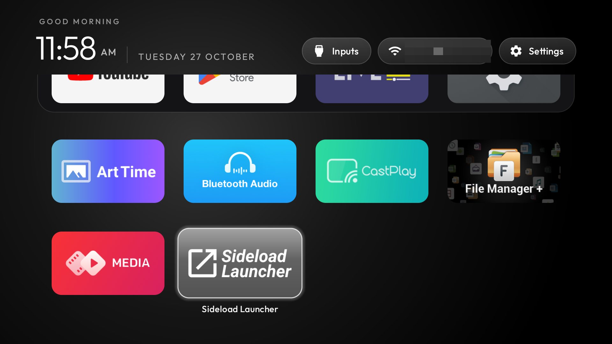
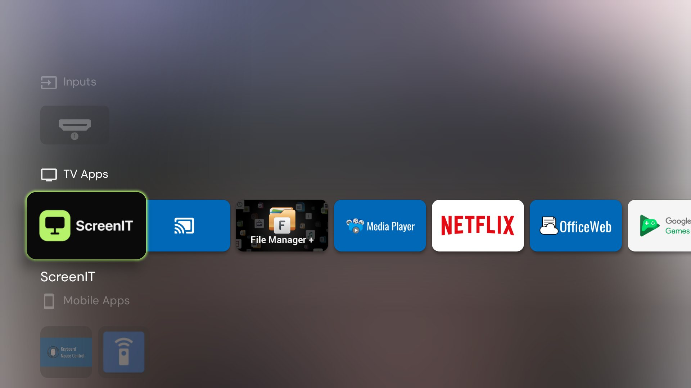
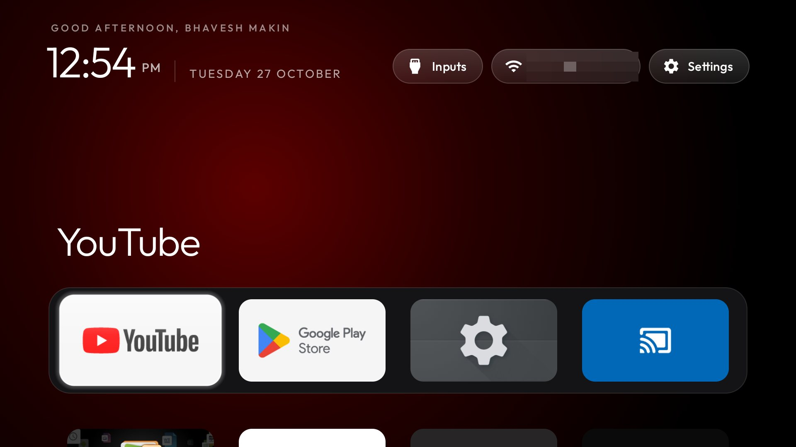
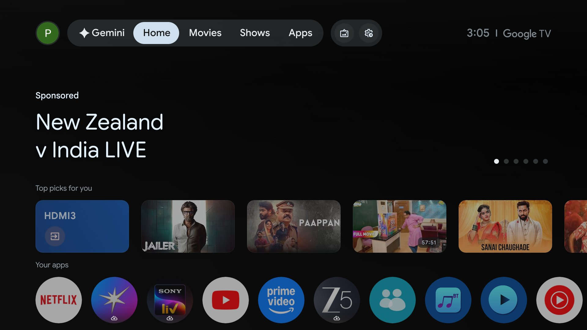
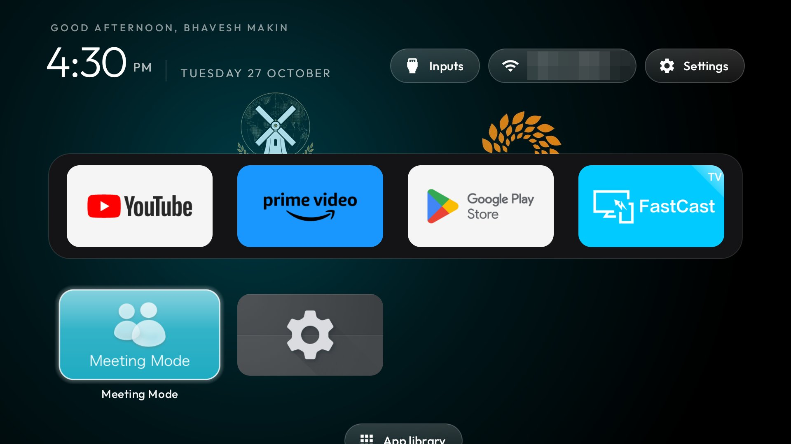

# clean-tv-home

Three Android TVs moved off the cluttered stock Google TV and Projectivy home screens onto a clean home screen styled after Apple TV, with the manufacturers' trackers and bloatware switched off. Everything was done over ADB from a Windows PC with [cleanyourtv](https://github.com/Gathin23/cleanyourtv) and its reference launcher. Nothing was rooted, flashed or uninstalled: every change is `pm disable-user` and can be undone.

| | Motorola SW-22AE NF | Acer M1G | Acer R4G |
|---|---|---|---|
| Built by | Skyworth (board SW6H, MediaTek) | MOKA (board dahu, Realtek) | MOKA (board R4_GTV, Realtek) |
| Android | Android TV 14, build UTT1.250517.001 | Google TV 14, build UKR9.250818.062 | Google TV 14, build UKR1.260308 |
| RAM | ~1.9 GB | ~1.9 GB | 2 GB |
| Packages disabled | 28 | 20 | 13 |
| Survived a reboot | yes, all 28 | yes, all 20 | yes, plus 13 background-blocked |

## Motorola SW-22AE NF

| Before | After |
|---|---|
|  |  |
|  |  |

**Disabled:**
- Skyworth's after-sale push service, which can install APKs at boot
- Android's ad and personalisation services
- Coocaa recommendation rows and the partner row injector
- retail demos, the e-manual and disclaimer pop-ups
- Health Connect
- by choice: Netflix, Prime Video, YouTube Music, Play Games, Google Assistant and the Google screensaver

The stock Google TV home and the setup wizard are disabled too. The saved Wi-Fi network belonged to the system, not the setup wizard, so this was safe.

The full list, with reasons, is in [`motorola-sw-22ae-nf/debloat.txt`](motorola-sw-22ae-nf/debloat.txt). The launcher settings are in [`launcher-config.xml`](motorola-sw-22ae-nf/launcher-config.xml).

## Acer M1G

| Before | After |
|---|---|
|  |  |

**Disabled:**
- **Anoki ACR**, which recognises what's on screen for ad targeting and starts at boot
- ad, feedback and Google partner-setup services
- Realtek retail mode, OfficeWeb, the user guide and the partner row injector
- Health Connect and Play Games
- by choice: Netflix, YouTube Music, Assistant, the screensaver and the USB media player

**Kept on purpose: the stock Google TV home and the setup wizard.** On this board the setup wizard owns the saved Wi-Fi network and the Chromecast credentials. This firmware also ignores `set-home-activity`. So the launcher takes over the Home button with its accessibility helper and `stock_home_redirect`; see [`theme-config.json`](acer-m1g/theme-config.json).

The full list is in [`acer-m1g/debloat.txt`](acer-m1g/debloat.txt).

## Acer R4G

| Before | After |
|---|---|
|  |  |

**Disabled:**
- Android's ad services, the SCBC partner auto-installer and an ad-click boot receiver
- Google partner pings, the partner row injector, the hotspot, Health Connect and the USB media player
- by choice: Netflix (and its token manager)

**Blocked from running in the background instead:** this firmware re-enables some packages at every cold boot, so gdpr consent, feedback, partner setup, the demo stickers, signage, TV Manager, World Clock, Audio Link, Play Games, YouTube Music, Play Movies and Netflix get `RUN_ANY_IN_BACKGROUND ignore`. That survives reboots; see [`appops-blocked.txt`](acer-r4g/appops-blocked.txt).

**Home:** like the M1G, the stock home and setup wizard stay enabled and the launcher takes the Home button with its redirect. `home_long_press_home` stops the stock home flashing on each Home press. The theme also hides the re-enabled apps from Home and uses the logo wallpaper; see [`theme-config.json`](acer-r4g/theme-config.json).

**Speed:** animations run at 0.5x.

The full list is in [`acer-r4g/debloat.txt`](acer-r4g/debloat.txt).

## The home screen

The launcher is [cleanyourtv's](https://github.com/Gathin23/cleanyourtv/tree/main/launcher) `com.gathin.tvhome`, built from source:

- **Look:**
  - pitch-black background with a glow sampled from the focused app
  - a greeting, a thin clock and the date
  - frosted Inputs / Wi-Fi / Settings pills
  - a dock band with a glass highlight
- **Apps:**
  - an App library that can add any installed app to Home, including phone-only apps such as Tapo
  - hold OK on a tile to move or remove it
- **Power-on:** the TV opens Home instead of Live TV.

## Download the launcher

The APK installed on both TVs is attached to the [latest release](https://github.com/bhaveshmakin-hue/clean-tv-home/releases/latest) as `clean-tv-home-launcher.apk` (package `com.gathin.tvhome`, Android 8.0+).

**What's built in:**
- the Motorola's settings: the greeting name, the App library, Tapo on Home, and power-on to Home
- On the Acers, the `theme-config.json` overlays change the dock, the wallpaper and the Home redirect.

**Signing:** the APK is signed with a debug key, so it's for sideloading, not the Play Store.

**Install it:**
```bash
adb install -r clean-tv-home-launcher.apk
```
Then make it Home, as in step 4 under "Reproduce it". To change the settings baked in at build time, build it yourself from [cleanyourtv](https://github.com/Gathin23/cleanyourtv).

## Reproduce it

1. Turn on Developer options and USB/Network debugging on the TV.
2. Clone [cleanyourtv](https://github.com/Gathin23/cleanyourtv) and follow its `PROMPT.md`.
3. Apply a list with `tools/disable.ps1` (or `disable.sh`) in small batches.
4. Build and install the launcher with `launcher/build-and-install.ps1 -HomeKeyService`.
5. On the Acers, push the theme overlay with `tools/theme.ps1`.
6. When you're done, switch debugging off again.

To undo, run `tools/restore.ps1 <list>`. Any app can also be re-enabled in Settings → Apps.

## Notes

- **Firmware updates stay on** on all three TVs.
- **Casting on the R4G:** Chromecast shows as "Acer TV". If it drops off a phone's Cast list, restart the TV or the mesh Wi-Fi units. The phone's own Screen Cast panel is Miracast, which only works while the FastCast app is open.
- **Boot animation:** neither the boot animation nor the Motorola's "firmware updating, don't shut down" boot screen can be changed. They sit on read-only partitions, and the bootloaders are locked with no OEM unlock.
- **Privacy:** the Wi-Fi name is pixelated in the screenshots.

Debloat lists and launcher: [cleanyourtv](https://github.com/Gathin23/cleanyourtv), MIT licence ([`licenses/cleanyourtv-MIT.txt`](licenses/cleanyourtv-MIT.txt)). The launcher bundles the Outfit typeface under the SIL Open Font License ([`licenses/Outfit-font-OFL.txt`](licenses/Outfit-font-OFL.txt)).
